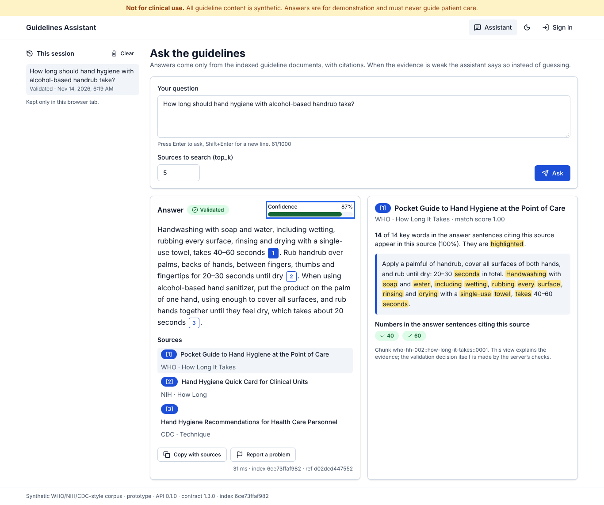
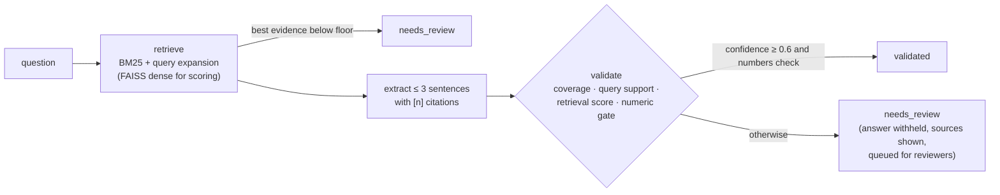

# Healthcare Guidelines RAG Assistant: Rapid Query & Validation System

> ⚠️ **Not for clinical use.** All guideline content in this repository is **synthetic**
> (WHO/NIH/CDC-*style*, not real guidance). This is an engineering prototype. Never use
> its output to make patient-care decisions.

A citation-first question-answering service over clinical guideline documents. It
answers **only** from retrieved guideline text and cites every sentence. It checks each
answer against that evidence and **abstains** (`status: needs_review`) when the support
is weak. The synthetic corpus can be replaced by an organisation's secure guideline
repository ([RUNBOOK §4](RUNBOOK.md#4-swapping-in-a-secure-real-guideline-repository)).



**Start here:** [technical summary](docs/technical-summary.md) (2–3 pages, for
stakeholders) · [evaluation report](docs/evaluation-report.md) ·
[architecture](docs/Architecture.md) · [API](docs/API.md) · [RUNBOOK](RUNBOOK.md) ·
[decisions (ADRs)](docs/adr/README.md) · demo video: attached to every
[GitHub Release](docs/releasing.md), or run `scripts/demo-record.sh`.

## Results

Held-out test set (83 answerable + 12 unanswerable questions), configuration frozen
before the run. Every number is re-derived by `scripts/reproduce.sh`.

| Criterion | Target | Result | |
| --- | --- | --- | --- |
| SC1 deterministic, API-free index | byte-identical | identical across builds, hash seeds, Linux and Windows | ✅ |
| SC2 Precision@5 | ≥ 0.65 | **0.417**. Ceiling with honest labels: 0.583; 72% of it; Hit@5 0.952 | ❌ as written ([why](docs/evaluation-report.md#31-why-p5-cannot-reach-065-here)) |
| SC3 validation pass rate @ τ 0.6 | ≥ 80% | **80.7%** (95% CI 72–89%) | ✅ |
| SC4 stable REST endpoint | 0 violations | every operation fuzzed (Schemathesis); 0% errors under load | ✅ |
| False validations (unanswerable) | ≤ 5% | 2 / 12 (causes identified) | ❌ |
| `/qa` latency | p95 < 300 ms | **179 ms** at 50 concurrent users, 0% 5xx | ✅ |

Dev pool (144 questions): P@5 0.602 (ceiling 0.826), pass rate 92.6%, 0 / 22 false
validations. Interpretation, intervals, ablations and limitations are in the
[evaluation report](docs/evaluation-report.md).

## How it works



```text
React SPA ─HTTPS─► Gateway / nginx ─► FastAPI (stateless, 2–6 pods) ─► PostgreSQL
 assistant + dashboard                  │   query log (redacted), reviews,
                                        │   config, eval runs, audit
                                        ◄── rag-index:<version> (immutable image, built by CI from corpus/)
```

Details: [architecture](docs/Architecture.md) · [plan](plan.md).

## Quick start

Prerequisites: Git, [uv](https://docs.astral.sh/uv/), Node 26 (`.nvmrc`), PowerShell 7+
on Windows; Docker for containers; kind + kubectl for Kubernetes; ffmpeg for the demo
video. `scripts/preflight.sh` checks them. Every script has a PowerShell twin
(`pwsh ./scripts/<name>.ps1`, same flags). Git Bash is the primary shell on Windows
([working agreements](docs/project/working-agreements.md)).

**Local** (API on :8000, Swagger at `/docs`; web app on http://localhost:5173):

```bash
scripts/setup.sh                 # toolchain check, .env, locked dependencies, hooks, lint + tests
scripts/build-index.sh           # deterministic index from corpus/
scripts/seed.sh --demo           # database + admin/reviewer/user accounts + a week of history
scripts/dev.sh                   # API + web together
```

**Docker Compose** (http://localhost:8080):

```bash
scripts/docker-up.sh --demo [--observability]     # + Prometheus :9090, Grafana :3000
```

**Kubernetes** (kind + Envoy Gateway, http://localhost:8088):

```bash
scripts/k8s-up.sh                # cluster, gateway, images, migrations, seed, smoke test
scripts/k8s-verify.sh            # zero failed requests during rolling restart + index rollback
```

Demo accounts: `admin@example.org`, `reviewer@example.org`, `user@example.org`. The
password is `SEED_ADMIN_PASSWORD` (dev default `change-me-admin`; Compose and kind
generate one: see `deploy/README.md`).

```bash
curl -s -X POST http://127.0.0.1:8000/api/v1/qa -H 'Content-Type: application/json' \
  -d '{"question": "What temperature range should refrigerated vaccines be stored at?", "top_k": 5}'
```

**Reproduce everything** (SC1–SC4, the held-out numbers, E2E, the demo video, the
submission bundle):

```bash
scripts/reproduce.sh             # ≈ 12 min; --quick = metrics only (≈ 3 min)
```

## Configuration

All settings come from environment variables or `.env` (created by `setup` from
[`.env.example`](.env.example), which documents every key; a unit test keeps the two in
sync). The ones you are most likely to change:

| Variable | Default | Purpose |
| --- | --- | --- |
| `APP_ENV` | `development` | `production` enables hard guards (strong `JWT_SECRET`, no question logging, no `*` CORS) |
| `DATABASE_URL` | SQLite file | `postgresql+asyncpg://…` in Compose/Kubernetes; empty = stateless `/qa` only |
| `CONFIDENCE_THRESHOLD` | `0.6` | τ for `validated`; can also be changed at runtime (Settings, audited) |
| `CONFIDENCE_WEIGHT_COVERAGE` / `_QUERY_SUPPORT` / `_RETRIEVAL` | `0.20` / `0.60` / `0.20` | Confidence blend (ADR-0002), sums to 1 |
| `RETRIEVAL_FLOOR` | `0.15` | Abstain if the best evidence is weaker than this |
| `RETRIEVAL_TOP_K_DEFAULT` / `_MAX` | `5` / `20` | `top_k` default and ceiling |
| `ALLOW_ANONYMOUS_QA` | `true` | `false` requires sign-in for `/qa` (production) |
| `LOG_QUESTION_TEXT` | `true` (dev) | Must be `false` in production (PHI) |
| `QUERY_LOG_RETENTION_DAYS` | `30` | Retention of the (redacted) query log |
| `RATE_LIMIT_QA`, `LOGIN_RATE_LIMIT` | `60/minute`, `10/minute` | Per-client limits (per pod) |
| `JWT_SECRET`, `SEED_ADMIN_PASSWORD` | dev values | Replace for any shared deployment |
| `CORPUS_DIR`, `INDEX_DIR` | `corpus`, `artifacts/index` | Index inputs and output; `CHUNK_*` and `EMBEDDING_*` change `index_version` |
| `GENERATOR` | `extractive` | `llm` is optional and off by default (needs `OPENAI_*`) |

## Scripts

| Script | Purpose |
| --- | --- |
| `preflight` | Read-only toolchain and repository hygiene check |
| `setup` | Clean machine → lint and tests green (`--ci`, `--skip-hooks`, `--no-verify`) |
| `lint` | ruff, mypy, contract snapshots, eslint, prettier, tsc for frontend and e2e (`--fix`) |
| `test` | pytest, vitest, Playwright (`--backend`, `--frontend`, `--e2e`, `--all`); `--coverage` enforces the coverage gates |
| `build-index` | Build and verify the index from `corpus/` (`--inspect`, `--out`) |
| `verify-determinism` | SC1: N isolated rebuilds with different hash seeds must be byte-identical |
| `eval` | Evaluation scorecard (SC2, SC3, false validations, analyst list); `--gate` for CI |
| `reproduce` | Every metric + E2E + demo from a fresh clone, compared with the records; submission bundle |
| `dev` | API (uvicorn `--reload`) and web (Vite) together |
| `smoke` | Probe a running API: health, both `/qa` paths, schema (`--base-url`, `--bench N`) |
| `db-migrate` | Alembic migrations (`--revision`, `--downgrade`, `--current`) |
| `seed` | Admin account; `--demo` adds reviewer/user accounts and a week of history |
| `load-test` | k6 against `/qa`: 50 VUs × 5 min, p95 < 300 ms, 0% 5xx |
| `security-scan` | pip-audit, npm audit, bandit, gitleaks, trivy; `--images` scans the images |
| `docker-up` / `-down` / `-rebuild` / `-logs` | The Compose stack (`--demo`, `--observability`, `--volumes`) |
| `k8s-up` / `-down` / `-status` / `-port-forward` | kind + Envoy Gateway (`--recreate`, `--overlay prod` renders only) |
| `k8s-verify` | Zero failed requests during a rolling restart and an index rollout and rollback under load |
| `demo-record` | Cold start → narrated 1080p demo MP4 with chapters (`--gif`, `--target`) |
| `gen-client` | Export `openapi.json`, regenerate the frontend's API types (`--check`) |
| `github-protect` | Apply the branch and tag rulesets (`--dry-run`) |
| `clean` / `reset-env` | Delete reports (`--all`: also `artifacts/` and caches) / rebuild `.venv` and `node_modules` from the lockfiles |

## The web app

- **Query Assistant** (`/`):
  - status badge, confidence meter with the signal breakdown, and `[n]` citation chips;
  - an evidence panel that highlights the words a source shares with the answer and
    checks every number;
  - abstentions explain why, list the closest sources and offer **Escalate for review**.
- **Dashboard** (`/admin`, reviewer or admin):
  - overview KPIs;
  - review queue (approve, reject or correct; promote to the gold set);
  - query explorer;
  - evaluation runs with the threshold sweep and analyst list;
  - index versions;
  - audited settings with an impact preview;
  - audit log.
- WCAG 2.2 AA (axe gate on every route; Lighthouse accessibility 100), dark mode,
  responsive. The brief's optional Streamlit UI is replaced by this React app.

## Repository layout

| Path | Contents |
| --- | --- |
| `backend/` | FastAPI app, RAG library, evaluation harness, 535 tests ([README](backend/README.md)) |
| `frontend/` | React + TypeScript SPA ([README](frontend/README.md)) |
| `corpus/` | 72 synthetic guideline documents ([corpus card](corpus/CORPUS_CARD.md)) |
| `e2e/` | Playwright E2E + accessibility gate, the recorded demo, k6 load test ([README](e2e/README.md)) |
| `deploy/` | Dockerfiles, Compose, Kubernetes, alert rules ([README](deploy/README.md)) |
| `scripts/` | Ops scripts, `.sh` + `.ps1` pairs |
| `docs/` | Architecture, API, evaluation, ADRs, releasing, phase reports ([project](docs/project/)) |
| `.github/` | CI, release and demo workflows; rulesets; Dependabot |

## Project status

Phases 0–11 of [`plan.md`](plan.md) are delivered. Phase 12 (final review) is re-opened until the manual frontend walkthrough on each deployment target is done, and Phase 13 (handoff documentation clean-up) is in progress; see [`test-plan.md`](test-plan.md). Each has a report in
[`docs/project/`](docs/project/), ending with the
[final review](docs/project/phase-12-report.md). Open items: ADR-0001 and ADR-0002
await mentor sign-off, and the SC2 reading is a pending decision
([technical summary §5](docs/technical-summary.md#5-decisions-needed)). Further open
issues are in `plan.md` §10.

## Documentation

| Document | Covers |
| --- | --- |
| [Requirements](docs/Requirements.md) | Problem, functional and non-functional requirements, success criteria |
| [Architecture](docs/Architecture.md) | Context, request sequence, modules, data, deployment, quality attributes |
| [Tech stack](docs/Tech-Stack.md) | Languages, frameworks and tools with pinned versions |
| [Backend](docs/Backend.md) | FastAPI layers, the `/qa` pipeline, configuration, backend tests |
| [Frontend](docs/Frontend.md) | React app structure, screens, auth, accessibility |
| [API](docs/API.md) | Endpoints, contract versions, examples, errors |
| [Database](docs/Database.md) | Tables, migrations, retention, seeding |
| [Data](docs/Data.md) | Synthetic corpus, index artifacts, gold evaluation sets |
| [Development](docs/Development.md) | Setup, daily loop, branching, Windows notes |
| [Scripts](docs/Scripts.md) | Every ops script and its flags |
| [E2E](docs/E2E.md) | Playwright E2E, demo video, load test, manual testing |
| [Deployment](docs/Deployment.md) | Local, Docker Compose, Kubernetes, production overlay |
| [Deliverables](docs/Deliverables.md) | Brief deliverables mapped to code and status |
| [Roadmap](docs/Roadmap.md) | Open decisions, quality work, backlog |
| [Evaluation report](docs/evaluation-report.md) | Method, results, ablations, limitations |
| [Technical summary](docs/technical-summary.md) | Two-page overview for stakeholders |
| [RUNBOOK](RUNBOOK.md) | Operations, releases, swapping in a real guideline repository |
| [Releasing](docs/releasing.md) | CI/CD, branch protection, release process |
| [ADRs](docs/adr/README.md) | Architecture decisions |
| [Test plan](test-plan.md) | Manual test checklist per phase and deployment target, open items |
| [Project reports](docs/project/) | Phase reports and the manual test log |

## Contributing and licence

[CONTRIBUTING.md](CONTRIBUTING.md) (trunk-based, Conventional Commits, `ci-passed`
required). Releases: [docs/releasing.md](docs/releasing.md).

**Licence: not yet granted.** This repository is prepared for handoff, and the licence is
the client's choice. Until the client adds one, no licence is granted and all rights are
reserved by the copyright holder. Third-party software in the images and web bundle keeps
its own licences: [THIRD_PARTY_NOTICES.md](THIRD_PARTY_NOTICES.md).
