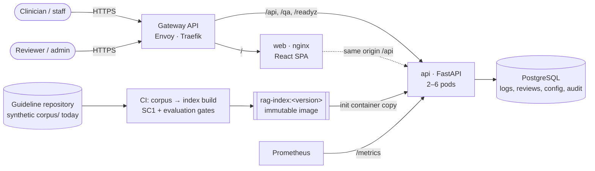

# Architecture

How the Healthcare Guidelines RAG Assistant is built, and why. Decisions are recorded
as ADRs in [`adr/`](adr/README.md). This page links them rather than repeating them.

## 1. Goals and constraints

| Driver | Consequence |
| --- | --- |
| Answer **only** from authoritative guidance, with citations | Extractive answers. Every sentence is copied from a cited chunk (ADR-0007) |
| **Validate** every answer, **abstain** when support is weak | A validator with several independent signals and a numeric hard gate; abstention is a first-class response (ADR-0002, ADR-0007) |
| **Deterministic** indexing, no external API (SC1) | Hashed 256-D embeddings, exact FAISS, byte-identical builds on Linux and Windows (ADR-0003, ADR-0005) |
| Swap the synthetic corpus for a secure repository later | One `DocumentSource` seam; the API never talks to the repository (RUNBOOK §4) |
| Clinical context: privacy and safety | PHI redaction, no question text in production logs, retention, persistent disclaimer (ADR-0009) |
| A trainee project that must be production-shaped | Modular monolith, not microservices; Kubernetes-ready, but runs on a laptop |

## 2. System context



## 3. The `/qa` request

```mermaid
sequenceDiagram
  participant C as Client
  participant R as Route /api/v1/qa
  participant S as QAService
  participant X as Retriever (BM25 ⊕ dense, RRF)
  participant G as Extractive generator
  participant V as Validator
  participant L as Query-log writer (async)
  C->>R: {question, top_k}
  R->>R: validate (3–1000 chars, top_k 1–20), rate limit, optional auth
  R->>S: answer() in threadpool (CPU-bound)
  S->>X: expand query (acronyms, lay synonyms) → top_k chunks
  alt best cosine < retrieval floor
    S-->>R: needs_review (below_retrieval_floor) + candidate sources
  else
    S->>G: score sentences, MMR, ≤ 3 sentences, [n] markers
    S->>V: coverage · query support · retrieval score · numeric gate
    V-->>S: confidence; validated if ≥ τ (0.6) and numbers check
  end
  S--)L: outcome (question redacted before storage)
  R-->>C: {answer, citations, confidence, status, meta}
```

Confidence = 0.20 × coverage + 0.60 × query support + 0.20 × retrieval score. These
weights were chosen with 5-fold cross-validation on the dev pool. The numeric gate
requires every number in the answer to appear in its cited chunk. On abstention the
answer text is replaced by a fixed message, and up to 3 candidate sources are still
returned so the user can read them (ADR-0007). The withheld candidate answer is kept for
reviewers only.

Why each signal exists (evaluation report §4.1, dev AUC for answerable vs unanswerable):

| Signal | AUC | Role |
| --- | --- | --- |
| Token coverage | 0.50 | Required by the brief. It is ≈ 1.0 for any extractive answer, so it guards future LLM generation rather than discriminating today |
| Query support (IDF-weighted key terms in the best cited chunk) | 0.983 | The main signal: does one passage cover the whole question? |
| Retrieval score (cosine to the best cited chunk) | 0.81 | Catches questions with no relevant chunk at all |
| Numeric gate | — | Healthcare-specific hard check: doses, temperatures, intervals |

## 4. Modules (backend)

The dependency direction is `api → services → rag / repositories → domain`. The RAG
library has no web or database code and runs the same way in the API, the CLI, the
evaluation harness and the seed script.

| Package | Responsibility |
| --- | --- |
| `app/api` | Routes (thin), Pydantic schemas, dependency injection, RFC 9457 errors |
| `app/core` | Settings (validated, production guards), logging, metrics, middleware (request id, security headers), rate limiting, JWT/Argon2, PHI redaction |
| `app/domain` | Models (`Document`, `Chunk`, `Citation` …) and protocols (`Embedder`, `VectorStore`, `SparseIndex`, `Retriever`, `Generator`, `Validator`) |
| `app/rag/ingestion` | `DocumentSource` → loader (front-matter validation) → normaliser → heading-aware chunker |
| `app/rag/index` | FAISS `IndexFlatIP`, BM25, manifest (hashes, versions), registry (atomic hot swap) |
| `app/rag/retrieval` | Dense, sparse, query expansion, weighted RRF fusion with deterministic tie-breaks |
| `app/rag/generation` | Extractive answer: sentence scoring, MMR, citation markers |
| `app/rag/validation` | Tokeniser (numbers and units as atoms), coverage, support, numeric check, confidence |
| `app/rag/pipeline.py` | Offline build: corpus → chunks → embeddings → index + manifest |
| `app/services` | QA orchestration, query-log writer, auth, admin, runtime config, evaluation runs, index versions, retention |
| `app/repositories` | SQLAlchemy 2 async data access (one module per aggregate) |
| `evaluation/` | Gold data, P@K / nDCG / Hit / MRR with bootstrap CIs, validation metrics, threshold sweep |

Frontend: React 19 + TypeScript + Vite, TanStack Query, a generated OpenAPI client
(the contract cannot drift), Tailwind + Radix primitives (ADR-0012).

## 5. Data

| Table | Holds | Notes |
| --- | --- | --- |
| `users`, `refresh_tokens` | Accounts (Argon2), rotating refresh-token families | Roles: user, reviewer, admin |
| `query_log` | **Redacted** question, status, reason, confidence, signals, citations, latency, index version, escalation | Purged after `QUERY_LOG_RETENTION_DAYS` |
| `reviews` | Verdict (approve / reject / correct), note, corrected citations, promote-to-gold | Exported as gold candidates (JSONL) |
| `eval_runs` | Dev-pool evaluation runs started from the dashboard, with scorecards | The test split is never run from the API |
| `index_versions` | Known versions, manifest, active flag | The deployment wins in Kubernetes (ADR-0015) |
| `app_config` | Versioned runtime threshold and weights | Polled by every pod |
| `audit_log` | Who did what, with before and after values | Sign-ins, reviews, config, activations, purges |

The index is **not** in the database: it is a set of immutable files (`index.faiss`,
`bm25.json`, `chunks.jsonl`, `embedder.json`, `manifest.json`) whose `index_version` is a hash of the
corpus and build configuration.

## 6. Deployment views

| View | Shape | Details |
| --- | --- | --- |
| Local | `scripts/dev.sh`: uvicorn + Vite, SQLite | README |
| Compose | nginx → api → PostgreSQL on an internal network, index image → volume, optional Prometheus + Grafana | ADR-0014, `deploy/README.md` |
| Kubernetes | Gateway API, api (HPA 2–6, PDB) + web, migrate Job, index init container, restricted Pod Security, default-deny NetworkPolicies | ADR-0015 |
| Delivery | Build once (Buildx bake), test that build, publish to GHCR, promote by tag, prod manifests pinned by digest, SBOMs, optional Cosign | ADR-0016, `docs/releasing.md` |

## 7. Quality attributes and how they are verified

| Attribute | Mechanism | Evidence |
| --- | --- | --- |
| Reproducibility (SC1) | blake2b feature hashing, float32, sorted inputs, LF line endings, pinned libraries | CI `determinism` (Linux + Windows, byte compare) |
| Answer quality (SC2/SC3) | Hybrid retrieval with BM25 ranking, composite confidence | Evaluation gate in CI; `scripts/reproduce.sh` |
| Contract stability (SC4) | Pydantic models, OpenAPI snapshot, generated client | Schemathesis on every operation; snapshot test |
| Performance | In-memory exact search, CPU work in a threadpool, asynchronous logging | k6: 50 VUs × 5 min, p95 179 ms, 0% 5xx |
| Availability | Stateless pods, readiness on index + DB, `maxUnavailable: 0`, PDBs | Zero failed requests during rolling restarts and index rollback |
| Security | RBAC, JWT with rotation, rate limits, CSP, non-root read-only containers, NetworkPolicies, pinned and scanned supply chain | Bandit, pip-audit, npm audit, gitleaks, Trivy; RBAC matrix tests |
| Privacy | Redaction before storage, no question text in production logs, retention | `test_redaction.py`, RUNBOOK §6.4 |
| Accessibility | Radix primitives, WCAG 2.2 AA | axe gate on every route; Lighthouse 100 |
| Operability | Metrics, JSON logs with request ids, alert rules with runbook entries | `promtool test rules` |

## 8. Known limitations

Retrieval relies on lexical matching. The hashed dense vectors do not capture meaning,
so paraphrases are the weak spot. Near-domain questions can be falsely validated
(2 / 12 on test-v2). Access control by document is designed, not built. These are listed
with their fixes in the [evaluation report](evaluation-report.md) §8, the
[technical summary](technical-summary.md) and `plan.md` §10.
