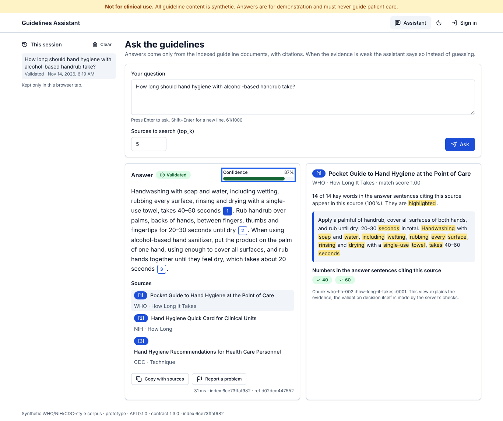

# Phase 6 Report — React Frontend: Query Assistant & Admin Dashboard

- **Date:** 2026-11-14 · **Plan ref:** `plan.md` §4 Phase 6 · Milestone M2 (frontend part)
- **Result:** every Phase 6 deliverable is built. Against the **real API** (seeded SQLite
  stack), 12 of 12 browser flows pass, axe-core finds **0 violations** on every screen in
  light and dark mode (colour contrast included), and Lighthouse scores
  **accessibility 100 and best practices 100 on all 9 routes**. **Exit criteria met.**
- **Safety finding** from the audit: one near-domain question is validated when it should
  not be (OI-27, below).
- **Contract:** 1.3.0, additive: `POST /api/v1/escalations`, a confidence histogram in
  `/admin/stats`, escalation fields on queries. `/qa` is unchanged.

## 1. Deliverables

### Query Assistant

| Plan item | Status | Where |
| --- | --- | --- |
| Question input, `top_k`, keyboard submit, loading/error/empty states | ✅ Enter asks, Shift+Enter adds a line; limits mirror the contract | `features/assistant/QuestionForm.tsx` |
| Answer card: status badge, confidence meter with signal tooltip, `[n]` chips | ✅ the meter marks the threshold; the tooltip opens on hover and keyboard focus | `AnswerCard.tsx`, `components/ui/status.tsx` |
| Evidence panel: overlapping tokens highlighted, numbers checked | ✅ compares the cited chunk with **the answer sentences that cite it** (not the whole answer); superseded sources flagged | `EvidencePanel.tsx`, `lib/evidence.ts` |
| Abstention UX: message, candidate sources, "escalate for review" | ✅ plain-language reason; escalation is a real API call (below) | `AnswerCard.tsx`, `EscalateButton.tsx` |
| Session history, copy with citations, disclaimer banner | ✅ history in sessionStorage (this tab only); copy includes sources and the disclaimer; banner on every route | `HistorySidebar.tsx`, `copy.ts`, `AppShell.tsx` |

### Admin Dashboard

| Plan item | Status | Where |
| --- | --- | --- |
| Overview: KPIs, trend, confidence distribution, top topics | ✅ plus abstention reasons; 24 h / 7 / 30 / 90-day windows | `features/admin/OverviewPage.tsx` |
| Review queue: side by side, approve / reject / correct, promote to gold | ✅ abstained **and user-escalated** items; corrected chunk ids validated | `ReviewQueuePage.tsx` |
| Query explorer: status, confidence, date, index-version filters, detail drawer | ✅ plus text search and sorting | `QueryExplorerPage.tsx` |
| Evaluation: history, P@K and pass-rate trend, sweep chart, low-confidence list, run button | ✅ polls while a run is in progress; run button for admins only | `EvaluationPage.tsx` |
| Index & corpus: versions with hashes, activate, inventory, rebuild (dev) | ✅ activation behind a confirmation dialog; failures shown in the dialog | `IndexPage.tsx` |
| Settings: threshold and weights editor with impact preview, audited | ✅ preview from the latest sweep; warns when weights differ from the evaluated run; 409 on concurrent edits | `SettingsPage.tsx` |
| Audit log | ✅ action prefix, actor, date filters | `AuditLogPage.tsx` |
| Route guards, 403 page, responsive layout, dark mode | ✅ reviewers never see the audit-log link; no horizontal scroll at 390 px | `RequireRole.tsx`, `AppShell.tsx` |
| WCAG 2.2 AA, keyboard navigation, axe in tests | ✅ see §3 | — |
| Vitest + RTL + MSW, stable `data-testid`s | ✅ 45 tests | `src/**/*.test.ts(x)`, `src/test/` |

### Stack and decisions (ADR-0012)

React 19, TypeScript strict, Vite 8, React Router 8, TanStack Query 5, React Hook Form + Zod 4,
Tailwind 4, Radix primitives in shadcn/ui-style components (written in the repo using
shadcn's pattern, not generated by its CLI), Recharts 3.

- **Generated client:** `scripts/gen-client.*` turns `backend/openapi.json` into TypeScript
  types; `lint` fails when they are stale.
- **Runtime check:** `/qa` answers are validated with Zod before rendering, so a malformed
  body can never show a "Validated" badge.
- **Tokens:** access token in memory; refresh token in the httpOnly cookie. On a 401 the
  client refreshes once and retries. A non-secret "signed in" flag avoids a failing
  refresh call for anonymous visitors (found by the audit: 3 console 401s, now 0).
- **Bundles:** the assistant loads 63 kB + 78 kB (React) + 37 kB (forms) gzip; dashboard
  pages and charts are lazy-loaded (OI-30).

### Backend additions for the UI (contract 1.3.0)

| Change | Why |
| --- | --- |
| `POST /api/v1/escalations` + migration `0002` (`escalated_at`, `escalation_note`, index on `request_id`) | "Escalate for review" needed a real action. A user can flag any answer, including a validated one they doubt. Notes are redacted; another user's answer returns 404 |
| Review queue `pending` = abstained **or escalated**, not yet reviewed | Escalations reach reviewers |
| `stats.confidence_histogram` (10 bands) | The overview's confidence distribution |
| Evaluation runs store the analyst `low_confidence` list | The evaluation page's list (the CLI already wrote it as CSV) |

## 2. Verification

| Check | Result |
| --- | --- |
| Frontend unit and component tests (Vitest + RTL + MSW, axe on each screen) | **45 passed**; coverage 90% lines |
| `tsc` strict · ESLint (type-aware, 0 warnings) · Prettier · API types current | clean |
| Backend tests | **464 passed** on SQLite + PostgreSQL 16 (Phase 5: 456); 423 + 41 skipped without PostgreSQL |
| ruff · mypy --strict · contract snapshots | clean |
| Production build | 1 s |

### Browser audit against the real API (`e2e/audit/ui-audit.mjs`)

Headless Chrome, the built SPA, a seeded API (62 demo questions), desktop 1366 px and mobile 390 px.

| Flow | Result |
| --- | --- |
| Assistant: validated answer, highlights, keyboard tooltip (Escape closes it) | ✅ |
| Assistant: abstention and escalation | ✅ |
| Sign in as admin, overview KPIs and charts | ✅ |
| Review queue: the escalated item is present; approve it | ✅ |
| Query explorer: filter and detail drawer | ✅ |
| Evaluation: start a run and wait for it to succeed | ✅ |
| Index and corpus · Settings: preview and save | ✅ |
| Audit log shows the UI's actions (escalation, review, settings, evaluation, login) | ✅ |
| Mobile 390 px: no horizontal page overflow | ✅ |
| Plain user is sent to the 403 page | ✅ |

| Route | Lighthouse accessibility | Best practices |
| --- | --- | --- |
| `/`, `/login`, `/admin`, `/admin/review`, `/admin/queries`, `/admin/evaluation`, `/admin/index`, `/admin/settings`, `/admin/audit` | **100** each | **100** each |

axe-core (WCAG 2.0/2.1/2.2 A and AA plus best practices, contrast included): **0
violations** on 12 screens × 2 themes. Raw results: `phase-6-ui/ui-audit-result.json`.

**The first audit run failed, and the failures were real.** Fixed before hand-off:

1. Mobile layout overflowed by 527 px (grid tracks sized to content). Then by 45 px: a
   `sr-only` table does not clip, because tables ignore `width`.
2. Recharts' keyboard layer made hidden charts focusable (`aria-hidden-focus`, Lighthouse 96–97).
3. Chart tooltips were unreadable in dark mode (contrast 1.2:1).
4. The disclaimer sat outside a landmark, and the sign-in page had no `<h1>`.
5. The evidence panel compared a source with the whole multi-source answer, so numbers
   from other sources showed as "not found". It now uses only the sentences that cite
   that source.
6. Anonymous visits made a failing refresh call (console 401s).

**Not verified here:** the audit ran headless in a Linux container (Chrome for Testing 153), not on
Windows or a real screen reader. A manual NVDA pass is worth doing before the demo (Phase 11).

## 3. Safety finding (OI-27, 🔴)

During the audit, *"What is the recommended dose of the yellow fever vaccine?"* (yellow
fever is not in the corpus) was **validated at confidence 0.6005**, with an answer
listing other vaccines' doses. At τ = 0.65 it abstains. This is the OI-18 failure class:
every key term exists in the evidence, but never together. It does not change Phase 4's
numbers, because the question is not in the gold sets. It is added to plan §10 for the
Phase 4.1 fix and should be part of test-v3. The UI makes the weakness visible: the
evidence panel showed only 27% overlap with each cited source.

## 4. Open issues

New: OI-27 (above), OI-29 (move the browser audit into Phase 7 CI), OI-30 (bundle budget).

## 5. Hand-off to Phase 7

Every interactive element has a stable `data-testid`. `e2e/audit/ui-audit.mjs` already
covers the main journeys against a real stack and is the natural seed for the Phase 7
Playwright suite.
